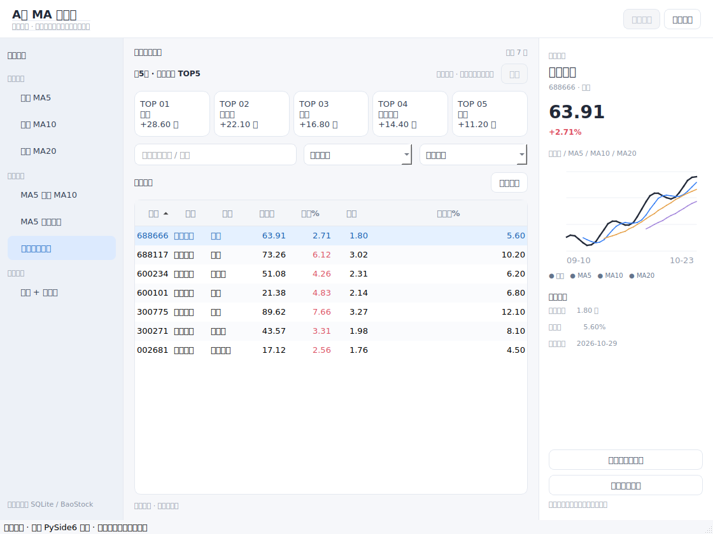

# PySide6 4:3 桌面界面预览

**这是新框架的可运行试验版，不是网页原型，也未合入 v1.2.6 正式版。**

## 界面



截图使用 **模拟股票与虚构资金值**，明确标记为演示。实际运行时会连接原有 BaoStock/SQLite 数据。

## Windows / macOS 使用

保持下面两个脚本在同一个文件夹内：

- `A股MA扫描器_PySide6_预览.pyw`：全新 Qt 界面
- `A股MA扫描器_v1.2.7.pyw`：现有 BaoStock 选股核心（仅导入，不会打开 Tkinter 主窗口）

依赖安装：

```bash
python -m pip install -r requirements-pyside6.txt
```

**先看效果，无需下载行情：**

```bash
python A股MA扫描器_PySide6_预览.pyw --demo
```

**使用真实数据库和每日更新：**

```bash
python A股MA扫描器_PySide6_预览.pyw
```

Windows 配置正确的 Python 文件关联后也可以双击 `.pyw`，不出现控制台。实际数据始终保存在脚本同目录的 `data/a_share_baostock_hfq.db`，**不要删除或移动此文件夹**。

## 近5日行业资金 TOP5（仅展示板块）

- 只获取 **近5日主力资金净流入前五的行业名称、名次和资金净额**。
- **不抓取成分股**、不进行板块成分股匹配、不用 TOP5 筛选股票；七种选股策略保持独立。
- 优先尝试记录表现较好的东方财富或同花顺排名接口；接口失败时自动切换另一来源。
- 资金净额统一换算为人民币元，界面以“亿元”显示。
- 五个排名全部有效才原子写入 SQLite；两家均失败时保留旧榜单并显示抓取时间和明确的错误信息。
- 已有 SQLite 数据库原位使用；仅在排名成功替换时清理旧版本遗留的成分股缓存。
- 演示模式所有榜单数值为虚构数据，不是实时行情。

## 当前验证范围

GitHub Actions 使用真实 PySide6 组件构造 4:3 窗口，测试左侧七种策略、仅展示的资金 TOP5 卡片、搜索、右侧图表和模拟数据，并自动生成屏幕截图。尚未验证真实 Windows GUI 与全市场联网行情，不创建 Release。

## 2026-10-29 云端接口验证

- AKShare 1.20.2 的东方财富行业排名接口在一次 GitHub 云端运行中返回 JSON 解析错误（可能与接口或网络环境有关）。
- 同花顺 5 日行业资金排名可以正常返回。此前的成分股接口缺失不再影响 TOP5 显示，因为现已**完全取消成分股抓取**。
- 当前开发版仅运行两个排名接口，详细错误保留供故障诊断。

参考之前的故障复现：https://github.com/Xstime/AShareMAScanner/actions/runs/40903607007
